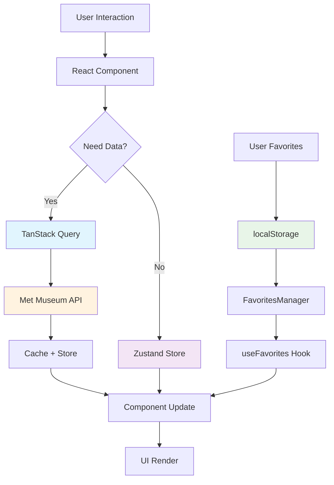

<p align="center">
   
</p>

# Art Explorer React

Uma aplicação web moderna para explorar obras de arte da coleção do Metropolitan Museum of Art (The Met), construída com **Next.js**, **TypeScript**, **React Query** e **Zustand**.

## 🌟 Sobre o Projeto

O Art Explorer permite que usuários naveguem, busquem e salvem suas obras de arte favoritas da vasta coleção do The Met Museum. A aplicação oferece uma interface responsiva e intuitiva com recursos avançados de filtragem e um sistema de favoritos persistente.

## ✨ Funcionalidades

- 🔍 **Busca Avançada** - Pesquise obras por termo livre ou filtre por departamento
- 🖼️ **Galeria Responsiva** - Visualize obras em grid adaptativo (1-5 colunas)
- ❤️ **Sistema de Favoritos** - Salve e gerencie suas obras favoritas (persistido no localStorage)
- 📱 **Design Responsivo** - Interface otimizada para desktop, tablet e mobile
- 🌙 **Dark/Light Mode** - Alternar entre temas claros e escuros
- ⚡ **Performance Otimizada** - Lazy loading, cache inteligente e carregamento em lotes
- 🎨 **Animações Suaves** - Transições fluidas com Framer Motion
- ♿ **Acessível** - Navegação por teclado e componentes semânticos

## 🚀 Começando

### Pré-requisitos

- **Node.js** 18+
- **pnpm** (recomendado) ou npm/yarn

### Instalação

```bash
# Clone o repositório
git clone https://github.com/jonathas3c/art-explorer-react.git
cd art-explorer-react

# Instale as dependências
pnpm install

# Configure as variáveis de ambiente
cp .env.example .env.local
```

### Variáveis de Ambiente

```bash
# .env.local
NEXT_PUBLIC_BASE_URL=https://collectionapi.metmuseum.org/public/collection/v1
```

### Executando o Projeto

```bash
# Desenvolvimento
pnpm dev           # Inicia servidor em http://localhost:3000

# Produção
pnpm build         # Gera build otimizado
pnpm start         # Inicia servidor de produção

# Outros comandos úteis
pnpm lint          # Executa linting
pnpm type-check    # Verifica tipos TypeScript
```

## 🏗️ Arquitetura do Sistema

### Estrutura de Pastas

```
art-explorer-react/
├── app/                      # App Router (Next.js 13+)
│   ├── (home)/              # Grupo de rotas da home
│   ├── artwork/             # Páginas de detalhes das obras
│   ├── favorites/           # Página de favoritos
│   ├── layout.tsx           # Layout raiz
│   └── globals.css          # Estilos globais
├── components/              # Componentes React reutilizáveis
│   ├── ui/                  # Design System (shadcn/ui)
│   ├── Artwork/            # Componentes específicos de obras
│   ├── SearchBar/          # Componentes de busca
│   ├── Navbar/             # Navegação
│   └── Favorites/          # Componentes de favoritos
├── hooks/                   # Custom React Hooks
├── lib/                     # Utilitários e configurações
├── stores/                  # Estado global (Zustand)
├── providers/              # Providers React (Query, Theme)
├── __tests__/              # Testes unitários
├── e2e/                    # Testes end-to-end
└── public/                 # Assets estáticos
```

### Stack Tecnológica

#### Frontend Core

- **Next.js 15** - Framework React com App Router
- **React 19** - Biblioteca para interfaces de usuário
- **TypeScript** - Tipagem estática
- **Tailwind CSS 4** - Framework CSS utility-first

#### Estado e Dados

- **Zustand** - Gerenciamento de estado global simplificado
- **TanStack Query** - Cache e sincronização de dados da API
- **React Hooks** - Lógica de estado local customizada

#### UI/UX

- **shadcn/ui** - Sistema de design com componentes acessíveis
- **Radix UI** - Primitivos de UI sem estilo
- **Framer Motion** - Animações e transições
- **Lucide React** - Ícones modernos
- **next-themes** - Gerenciamento de temas

#### Qualidade e Testes

- **Jest** - Framework de testes unitários
- **React Testing Library** - Testes de componentes
- **Playwright** - Testes end-to-end
- **ESLint + Prettier** - Linting e formatação
- **Husky** - Git hooks automatizados

## 🔄 Fluxo de Dados

### Arquitetura de Estado



### Componentes Principais

1. **API Layer** (`lib/api.ts`)
   - Classe `MetMuseumAPI` com métodos de busca
   - Retry automático e cache de requisições
   - Rate limiting e tratamento de erros

2. **Estado Global** (`stores/useArtworkStore.ts`)
   - Cache de obras carregadas
   - Estado de busca e paginação
   - Gerenciamento de departamentos

3. **Favoritos** (`hooks/useFavorites.ts` + `lib/favorites.ts`)
   - Persistência em localStorage
   - Eventos customizados para sincronização
   - Interface reativa com hooks

4. **Grid de Obras** (`components/Artwork/Grid/ArtworkGrid.tsx`)
   - Carregamento em lotes (15 itens por vez)
   - Layout responsivo adaptativo
   - Estados de loading, erro e vazio

## 🎨 Design System

### Componentes Base (components/ui/)

- **Card** - Sistema modular de cards
- **Button** - Botões com múltiplas variantes
- **Input/Select** - Componentes de formulário
- **Badge** - Etiquetas de categorização
- **Skeleton** - Placeholders de carregamento

### Temas e Responsividade

```css
/* Layout Grid Responsivo */
grid-cols-1           /* Mobile: 1 coluna */
md:grid-cols-2        /* Tablet: 2 colunas */
lg:grid-cols-3        /* Desktop: 3 colunas */
xl:grid-cols-4        /* Grande: 4 colunas */
2xl:grid-cols-5       /* Extra: 5 colunas */

/* Sistema de Temas */
.light {
  --background: 0 0% 100%;
  --foreground: 222.2 84% 4.9%;
}
.dark {
  --background: 222.2 84% 4.9%;
  --foreground: 210 40% 98%;
}
```

## 🧪 Testes e Qualidade

### Estratégia de Testes

- **Unit Tests (70%)** - Jest + React Testing Library

### Comandos de Teste

```bash
# Testes Unitários
pnpm test              # Executa todos os testes
pnpm test:watch        # Modo watch para desenvolvimento
pnpm test:coverage     # Relatório de cobertura (meta: 70%)

# Testes E2E
pnpm test:e2e          # Testes end-to-end completos
pnpm test:e2e:fast     # Apenas Chromium (mais rápido)
pnpm test:e2e:ui       # Interface visual do Playwright

# Validação Completa
pnpm validate          # lint + test + build
pnpm test:all          # unit + e2e
```

### Git Hooks

- **Pre-commit** - Formatação, lint e testes dos arquivos alterados
- **Pre-push** - Build, testes completos e E2E
- **Commit-msg** - Validação de formato de commit (Conventional Commits)

## 🚀 Performance

### Otimizações Implementadas

1. **Carregamento Otimizado**

   ```typescript
   // Batch loading de 15 obras por vez
   const batchSize = 15;
   const currentBatch = searchResults.slice(startIndex, endIndex);

   // Lazy loading de imagens
   <Image loading="lazy" sizes="(max-width: 768px) 100vw, 50vw" />
   ```

2. **Cache Inteligente**

   ```typescript
   // Cache em múltiplas camadas
   // 1. TanStack Query (API cache)
   // 2. Zustand Store (dados carregados)
   // 3. Next.js (revalidation cache)
   ```

## 📱 Responsividade

### Breakpoints Tailwind

```css
sm: 640px    /* Tablet pequeno */
md: 768px    /* Tablet */
lg: 1024px   /* Desktop */
xl: 1280px   /* Desktop grande */
2xl: 1536px  /* Extra grande */
```

### Layout Adaptativo

- **Mobile** (< 768px): 1 coluna, navegação collapsed
- **Tablet** (768px - 1024px): 2-3 colunas, layout híbrido
- **Desktop** (> 1024px): 3-5 colunas, layout completo

## 🔧 Configuração Avançada

### Environment Variables

```bash
# Configuração da API
NEXT_PUBLIC_BASE_URL=https://collectionapi.metmuseum.org/public/collection/v1
```

## 📚 Recursos Úteis

### Documentação

- [Next.js Documentation](https://nextjs.org/docs)
- [TanStack Query](https://tanstack.com/query/latest)
- [Zustand](https://github.com/pmndrs/zustand)
- [Tailwind CSS](https://tailwindcss.com/docs)
- [The Met Museum API](https://metmuseum.github.io/)

### Arquivos de Configuração

- [`TESTING.md`](./TESTING.md) - Guia detalhado de testes
- [`GIT-HOOKS.md`](./GIT-HOOKS.md) - Workflow de git hooks
- [`THOUGHTS.md`](./THOUGHTS.md) - Decisões de arquitetura

---

2025, Jonathas Germano de Oliveira
